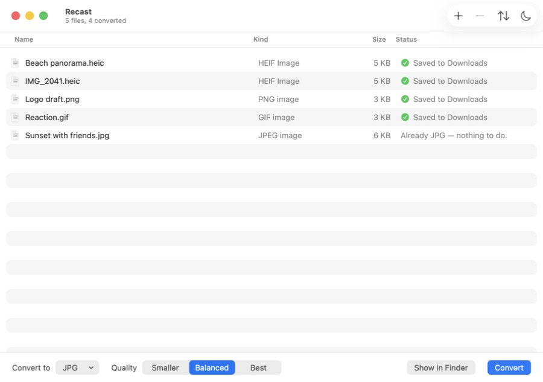
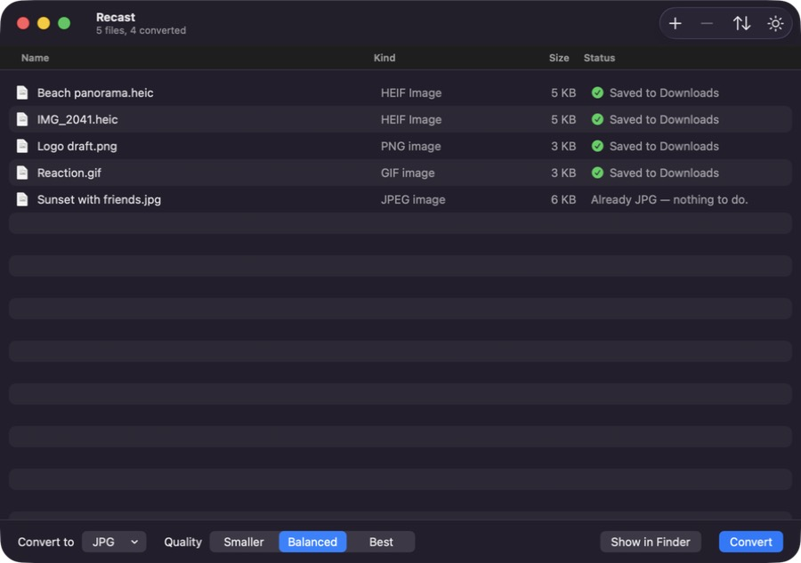

# Recast

A free, offline file converter for the Mac. Drop files in, pick a format, done.

<p align="center">
  
  
</p>

## Why I built it

Converting a file on a Mac shouldn't be this hard. The tools built into macOS only cover part of the job (Finder's Convert Image handles JPEG, PNG and HEIF, and that's about it), and the polished all in one converters cost money. So most people end up on free converter websites full of ads and fake download buttons.

That's a real risk now. In March 2025 the FBI [warned](https://www.cbsnews.com/amp/colorado/news/fbi-online-file-converter-malware-steal-private-information) about a growing number of free online converters that hand your file back with malware hidden inside, leading to things like ransomware and stolen identities.

And it's only getting worse. The FBI's latest [Internet Crime Report](https://cyberscoop.com/fbi-internet-crime-complaint-center-annual-cybercrime-report/), released in April 2026, logged over a million complaints for the first time ever, with Americans reporting nearly $21 billion in losses, up 26% from the year before.

On top of that, the biggest organizations in the world are getting hit. In 2026 alone:

- Hackers [breached an FBI surveillance system](https://techrepublic.com/article/news-china-linked-fbi-surveillance-breach-major-incident), and the Justice Department declared it a "major incident."
- Someone had access to [Pentagon personnel records](https://www.nextgov.com/cybersecurity/2026/10/pentagon-personnel-breach-undetected-months-renews-cyber-standard-scrutiny/416414/) for about nine months before anyone noticed.
- Hackers [stole and published data on more than 41,000 Homeland Security workers](https://www.malwarebytes.com/?p=482644).
- A cyberattack [disrupted global operations at Boston Scientific](https://www.integrity360.com/cyber-news-roundup-august-28-2026).
- In October, two critical flaws in PHP, the language behind sites like WordPress, were [exploited in the wild](https://bleepingcomputer.com/news/security/php2shell-security-flaws-now-sucessfully-exploited-in-the-wild).

If the FBI and the Pentagon can't keep attackers out, I'm not trusting a random converter website with my files.

I wanted something better: one free app that lives on my Mac, handles the everyday conversions, and never sends a file anywhere. So I built Recast.

## What it does

- Drop files on the window, on the Dock icon, or right click a file in Finder and pick **Convert with Recast**.
- It only shows you formats that actually make sense for the files you dropped.
- Batches convert in parallel, and every file shows its own progress. If one fails, you get a plain English reason and the rest keep going.
- Everything lands in your Downloads folder with the same name and the new extension. It never overwrites anything and never touches your originals.
- One quality setting (Smaller, Balanced or Best), plus a resolution option when you're converting video.
- Turn a bunch of images into one combined PDF, in whatever order you drag them into.
- Multi page PDFs and multi sheet spreadsheets come out as separate files, or all in one folder if you prefer.
- Light mode, Dark mode, or just match your Mac.
- Everything happens on your Mac. Your files never get uploaded anywhere.

## Supported formats

| Group | Formats | Also converts to |
|---|---|---|
| Images | jpg, png, heic, webp, tiff, bmp, gif | pdf |
| Video | mp4, mov, mkv, webm, avi | gif, any audio format |
| Audio | mp3, wav, m4a, aac, flac, ogg | any audio format |
| Documents | docx, odt, rtf, txt | pdf |
| Presentations | pptx, odp | pdf |
| Spreadsheets | xlsx, ods, csv | pdf |
| PDF | pdf | png, jpg |

Formats in the same group convert to each other too, so docx to odt or xlsx to csv works fine.

## Install

### What you need

- An Apple Silicon Mac on macOS 14 or newer
- Homebrew, with FFmpeg and LibreOffice:

  ```sh
  brew install ffmpeg
  brew install --cask libreoffice
  ```

  If either one is missing, Recast shows a banner with an Install button and sets it up for you.

### Download

1. Grab `Recast.zip` from the [Releases](https://github.com/Gandhiaayush04/recast/releases) page.
2. Unzip it and drag `Recast.app` into Applications.
3. The first time you open it, macOS will block it because I haven't paid for Apple's notarization. Go to System Settings, then Privacy & Security, scroll down to the message about Recast and click **Open Anyway**.
4. macOS might ask once for access to your Downloads folder. Say yes, since that's where your converted files go.

### Add the Finder shortcut (optional)

1. Grab `Convert-with-Recast-Quick-Action.zip` from the same [Releases](https://github.com/Gandhiaayush04/recast/releases) page and unzip it.
2. Double click `Convert with Recast.workflow` and click **Install**.
3. Right click any file, go to **Quick Actions**, then **Customize…**, and make sure **Convert with Recast** is ticked.

### If macOS says Recast is damaged

That's macOS being extra cautious with apps downloaded from the internet that aren't notarized. Open Terminal and run this once, then open Recast again:

```sh
xattr -dr com.apple.quarantine /Applications/Recast.app
```

## Build it yourself

You'll need Xcode and Homebrew. Clone the repo and double click these three scripts in order:

1. `1-install-engines.command` installs FFmpeg and LibreOffice through Homebrew.
2. `2-setup-xcode-and-test.command` sets up Xcode, downloads a private copy of Python for the app and runs the tests.
3. `3-build-app.command` builds Recast, runs the tests again and installs it into Applications.

## How it works

- **The app** is written in SwiftUI (`app/`). It hands each job to the conversion engine and shows live progress.
- **The engine** is a Python package (`engine/recast_engine`) bundled inside the app. The two talk to each other through JSON lines.
- **Under the hood** it uses FFmpeg for video and audio, LibreOffice (headless) for documents, Pillow and the Mac's built in `sips` tool for images and HEIC, and pypdfium2 for turning PDF pages into images.
- **Tests:** there are over 230 automated tests in `engine/tests`, covering every conversion pair.

I built Recast with Claude as my coding partner. I set it up so Claude Opus handled the planning, reviews and the core engine and app, while smaller Sonnet and Haiku agents built the individual converters, tests, icon and docs in parallel. Fresh reviewers checked the plan and the code before anything shipped.

## Security

Recast never touches the network. Documents that try to pull in images or files from somewhere else get refused, media files are only opened as real audio and video formats, and oversized images and PDFs are stopped before they can eat up your memory. If you find a security problem, please report it privately as described in [SECURITY.md](SECURITY.md).

## Third party software

Everything Recast bundles or relies on, and their licenses, is listed in [THIRD_PARTY.md](THIRD_PARTY.md).

## License

MIT. Copyright (c) 2026 Aayush Gandhi. See [LICENSE](LICENSE).
